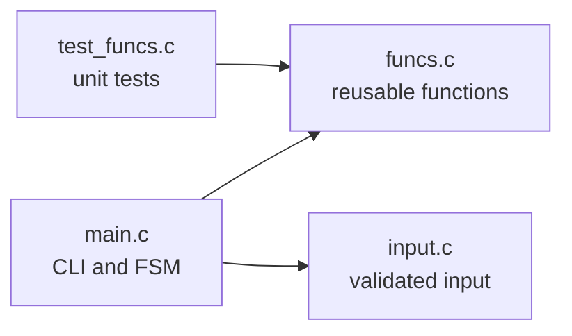

# ELEC2645 Unit 2 Project Template

> **Replace this README with your own project README.** Your final README should explain your application's purpose, features, file structure, build command, run command, test command and any known limitations.

This template provides a small working command-line finite state machine with two example options:

1. square an integer
2. cube an integer

The examples are deliberately simple. Replace and extend them to create your own original Unit 2 application.

## File structure

```text
main.c          command-line interface and finite state machine
input.c/.h      validated user-input helper
funcs.c/.h      reusable application functions
test_funcs.c    separate unit-test executable
Makefile        build instructions
.vscode/        VS Code build and debugger configuration
```

The same reusable functions are compiled in two ways:



## Build and run the application

```bash
make application.out
./application.out
```

Equivalent GCC command:

```bash
gcc -Wall -Wextra -Wpedantic -std=c11 -g -O0 \
    main.c funcs.c input.c -o application.out
```

## Build and run the tests

```bash
make test
```

This compiles and runs a second executable:

```text
test_funcs.c + funcs.c -> test_funcs.out
```

The tests call the reusable functions directly. They do not run `main.c` or require keyboard input.

## Extending the finite state machine

When adding a feature, you will normally need to:

1. add a state to `AppState` in `main.c`
2. add a menu option in `print_main_menu()`
3. return the new state from `run_main_menu()`
4. add a `case` for the state in the main FSM
5. implement the state action
6. move suitable reusable logic into a library function
7. add tests for that function

Do not simply add unrelated calculations. The states and features should work together as one coherent application.

## Adding or renaming source files

The Makefile does not discover source files automatically. If you add or rename files, update the source and header lists near the top of `Makefile`.

For example, if the application adds:

```text
quiz.c
quiz.h
```

change:

```makefile
APP_SOURCES := main.c funcs.c input.c quiz.c
APP_HEADERS := funcs.h input.h quiz.h
```

If the tests use `quiz.c`, also change:

```makefile
TEST_SOURCES := test_funcs.c funcs.c quiz.c
TEST_HEADERS := funcs.h quiz.h
```

If you rename the test file, replace `test_funcs.c` in `TEST_SOURCES` with the new filename.

Run a full rebuild after changing the Makefile:

```bash
make clean
make application.out
make test
```

## Updating VS Code build and debug settings

The `.vscode/tasks.json` file tells VS Code which Make target to build. The `.vscode/launch.json` file tells the debugger which executable to run.

You do not need to change these files when adding another `.c` file if:

- the Makefile includes the new file; and
- the output executable remains `application.out` or `test_funcs.out`.

If you rename an executable, update all matching names in:

```text
Makefile
.vscode/tasks.json
.vscode/launch.json
```

For example, if `application.out` becomes `quiz.out`, change:

```json
"program": "${workspaceFolder}/quiz.out"
```

and make sure the related VS Code task builds `quiz.out`.

If you add a new executable, create a corresponding build task in `tasks.json` and a debug configuration in `launch.json`.

## The static library variable

`funcs.c` contains:

```c
static int operation_count = 0;
```

Because the variable is declared outside a function, every function in `funcs.c` can access it. The `static` keyword prevents other `.c` files from accessing it directly.

Other files interact with the value through functions declared in `funcs.h`:

```c
int funcs_get_operation_count(void);
void funcs_reset_operation_count(void);
```

This provides an example of keeping implementation data private to one source file.

## Tests for your own project

Replace the example square and cube tests with tests for your own non-interactive functions. Include normal, boundary and invalid or error cases where appropriate.

A useful test should have:

- a clear name
- known inputs
- an expected result
- the actual result
- an obvious pass or fail outcome

The final project must include automated tests that can run without the interactive CLI.

## Write your own README

Before submitting the project, replace this template README with one written specifically for your application. At minimum, explain:

- what the application does and who it is for
- its main features and FSM states
- the purpose of each source and header file
- how to build and run the application
- how to build and run the automated tests
- expected input and output
- any known limitations
- any external sources that influenced the implementation

Do not leave this template text as your final project README.

## Assessment

Read the formal Unit 2 assessment brief and the Minerva project guidance before deciding the final scope of your application.
